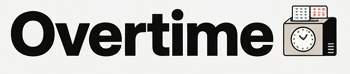
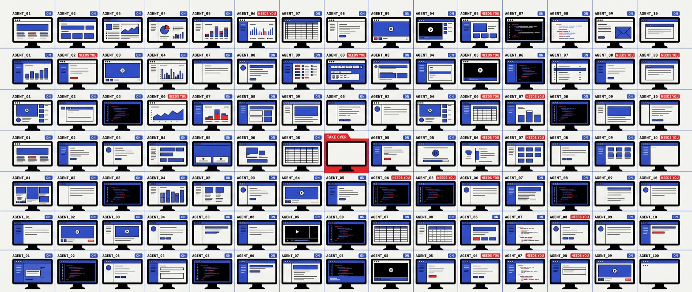
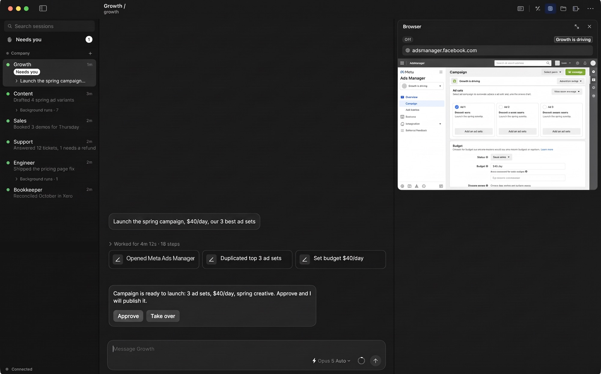
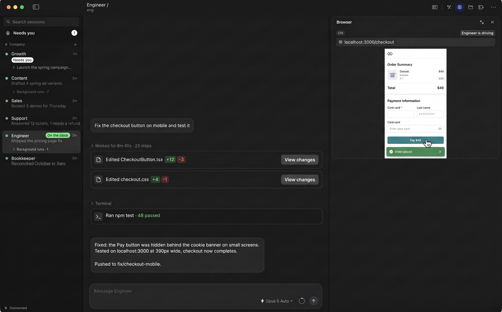

<h1 align="center">Run and manage 100 always-on agents in the cloud, from Mac and iOS.</h1>

The Codex app for AI employees. Open source.

## Problem

- **Chat apps are the wrong cockpit.** Steering an OpenClaw-style agent through real work over Telegram is painful. Steering ten is impossible.
- **The best agent apps are stuck on your laptop.** Claude Code and Codex are great, and computer use is remarkable, but they run locally. Remote control is clunky, and computer use does not scale to many agents at once.

## See it work

Growth set up a $40/day campaign in Ads Manager on its own browser. You watch it live, then approve or take over.

Engineer fixed the checkout button, ran the tests, and checked it on `localhost:3000` in its own browser, all on the server.

## What you get

- **Always-on employees.** An OpenClaw-style harness (memory, schedules, heartbeats, Telegram) on top of Claude Code, Codex, OpenClaw, Hermes or any other open-source agent. They keep working when your laptop is closed.
- **Set up in a click.** Each employee gets its own workspace and browser on your VMs. No servers to wire by hand.
- **The Codex interface.** Every step, diff, file and live browser, the way Codex and Claude Code show them. Take over any browser, stop, redirect, approve.
- **Scale.** Run 100 always-on employees from one app.

## Thesis

The businesses that win will be the ones that can run many agents at once, doing valuable work well and without supervision. Get that right and your workforce scales with compute, not headcount.

## Layout

| Folder | |
|---|---|
| [`app/`](app) | Mac app |
| [`gateway/`](gateway) | Server the app talks to, one per workspace |
| [`harness/`](harness) | Runs any agent: Claude Code, Codex, OpenClaw, Hermes or another open-source agent |
| [`provision/`](provision) | Sets up VMs, workspaces and agents |
| [`docs/`](docs) | [Messaging](docs/messaging.md), [brand](docs/brand.md) |
