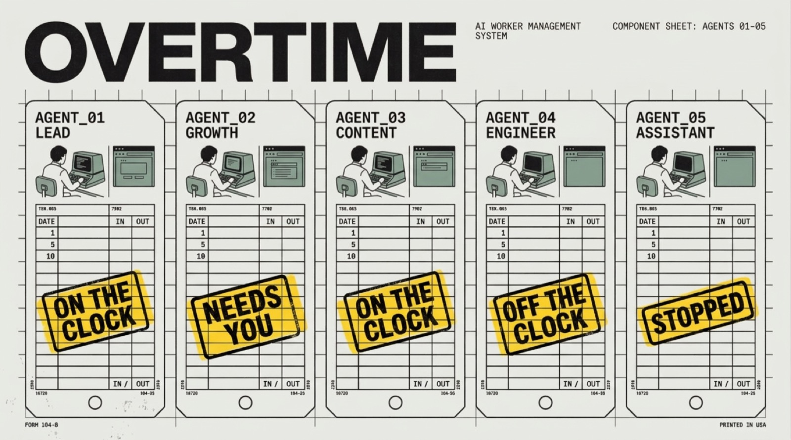

<p align="center"></p>

<h3 align="center">AI workers that never clock out.</h3>
<p align="center">Each one gets its own computer and browser. Watch them work, take over anytime.</p>

<p align="center"></p>

> **Private preview.** This repo is the public home of Overtime. The code moves here from its working repo once it is ready; for now it holds the plan, the brand and the docs.

## What it is

Overtime is a Mac app and a small server kit for running a team of AI workers on a machine you own. Each worker is a Claude Code or Codex agent with a role, its own files and memory, and its own desk: a computer and a browser it uses like a person would. You hand out work in plain language, they do it while you sleep, and anything with consequences waits for your OK.

It is built for founders and small teams who want agents doing real work in real accounts: running ads, writing and posting content, chasing leads, keeping the books tidy. Not demos in a sandbox.

## Why it is different

- **A desk per worker.** Workers use real apps and a real browser with your logins, not a list of API integrations.
- **Watch live, take over anytime.** Open a worker's desk and see its screen. Hit Take over to log in, pass a 2FA prompt or fix something by hand, then hand it back.
- **Nothing consequential without you.** Sending, posting, buying and deleting wait for your approval. Browsing, reading and drafting do not.
- **Your server, your subscriptions.** Runs on your own VPS or Mac with your own Claude Code and Codex logins. No per-seat cloud, no keys handed to us.
- **Separate workspaces.** Company and personal workers live in separate workspaces with separate files, logins and browsers, so nothing crosses over.
- **One team, any channel.** The same workers answer in the Mac app and on Telegram.

## How it works

```
 Mac app (you)  ──Tailscale──▶  Gateway, one per workspace
                                  ├─ Workers: Claude Code or Codex, each with a role, files and memory
                                  ├─ Desks: a real Chrome per workspace (per worker, next), streamed live
                                  └─ Jobs: schedules, heartbeats, the weekly timesheet
```

## Status

| | Today | Next |
|---|---|---|
| Mac app: chat, files, diffs, schedules, asks | Working | Polish, iOS app |
| Claude Code and Codex workers | Working | More harnesses |
| Live desk with take over | One shared browser per workspace | A full computer per worker |
| Approvals | Ask before consequential actions | Approve with a screenshot of the filled form |
| Weekly timesheet | Planned | Shareable card, numbers from connected sources |
| Install | Manual | One command |

## The words we use

| Word | Means |
|---|---|
| Worker | An AI agent with a role |
| Desk | A worker's own computer and browser |
| On the clock | Working right now |
| Needs you | Waiting on your approval, login or answer |
| Take over | You drive the worker's desk |
| Timesheet | What your workers did this week |

## Repo layout

| Folder | What will live there |
|---|---|
| [`app/`](app) | The Mac app (SwiftUI) |
| [`gateway/`](gateway) | The per-workspace server the app talks to |
| [`harness/`](harness) | Runs a worker on Claude Code or Codex |
| [`provision/`](provision) | Scripts that set up a box, a workspace and a worker |
| [`docs/`](docs) | [Messaging](docs/messaging.md), [brand](docs/brand.md) and assets |

<p align="center"></p>
